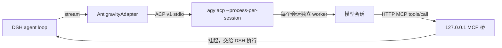

# dsh-llm-antigravity-acp

把本机已登录的 Google Antigravity CLI（`agy`）作为 DeepSeek Harness 的一级模型 provider 接入。模型出现在输入框右下角的模型选择器里，与 DeepSeek、GLM 等直连 provider 同级使用；工具、权限、压缩、子代理全部由 DSH 负责。

## 工作方式



| 环节 | 做法 |
|---|---|
| 进程 | 由 `ctx.subprocess` 启动本机官方 `agy acp`，凭据留在官方进程与系统凭据库（macOS 钥匙串 / Windows 凭据管理器） |
| 客户端标识 | ACP `clientInfo` 使用官方客户端标识 `antigravity`，版本取 `agy --version` 的 `major.minor.patch`（读不到时为 `1.5.5`）；`agy acp` 启动参数带 `--override_user_agent_name antigravity`，Cloud Code 请求的 `User-Agent` 与官方客户端一致 |
| 隔离 | 独立 `--gemini-dir`（默认 `$DSH_HOME/cache/antigravity-acp`），预置 `settings.json` 默认 `"Gemini 4 Argon (High)"` 与 `"512K"`，并从本机 `~/.gemini/config/config.json`（`userSettings.useAiCredits`）与 `~/.gemini/antigravity-cli/settings.json` 同步 Google One AI Credits 开关；预置 `config/projects/default-cli-project.json`（消除每步的 `project_store_get_file_missing`）与 `agy/cache`、`antigravity-cli/cache` 下已完成的 `onboarding.json`。默认 `bridge` 模式以 `dsh-bridge` agent（`tools: []` + `excludeDefaultComponents: true`）去掉全部内置文件/终端工具；切换为 `native` 模式时不传 `--agent`，保留 Antigravity 原生 `<identity>` 与内置工具。多账号时每个账号另有独立 `$HOME` 与独立凭据沙箱，见下节 |
| 引擎模式 | `engineMode` 支持 `bridge`（默认，DSH 工具桥接）与 `native`（原生 Agent 满血模式），可在设置页即时切换并自动重启活跃 ACP 进程。`native` 模式下会话 `cwd` 直接绑定当前工作区目录，自动过滤重叠的 DSH 文件/终端工具（`read`、`write`、`edit`、`bash`、`glob`、`grep`、`working_directory`、`job_*`、`*_mcp_resource*`），保留全部 DSH 子代理、Team、Workflow、Skill、`todo_write`、`ask_user_question`、`present`、Goal、Schedule、Web 与自定义插件工具；`agy` 内置工具权限严格对齐当前 DSH `sandbox:policy`（`read-only` / `workspace-write` 路径与软链边界校验 / `danger-full-access`），内置工具步骤实时以 `[agy]` 摘要写入思考流 |
| 工具 | DSH 工具经每会话独立的 MCP 端点暴露为 `mcp_dsh_<name>`，超出 eager 阈值的工具完整描述同步写入 `<harness_tool_contracts>`；声明 `toolUpdate: in-history`，中途动态增删工具通过 `<harness_tool_update>` 与 `dsh_call_tool` 原地执行，让同一 ACP 会话的前缀保持稳定 |
| 长时工具 | agy 对单次 MCP 调用有 180 秒上限且 Gemini 隐式缓存存在空闲 TTL；默认超过 85 秒（`relayAfterMs`）的调用先返回“仍在运行”提示，模型调用 `dsh_await_result` 继续等待同一结果并刷新缓存活跃度，DSH 侧只看到一次工具调用 |
| 历史 | 同一 DSH 会话持续复用同一 ACP 会话，并在 `session-index.json` 持久化绑定，空闲回收或 DSH 重启后经原生 `session/load` 恢复原 SQLite 会话与 `thoughtSignature`；仅在上下文压缩或历史改写时以 `<dsh_history>` 转录重建（解锁时预算 2.2MB，未解锁时 160KB） |
| 系统提示 | 首次经 `_meta.antigravity.systemPrompt.append` 注入，同时将首轮 `AGENTS.md`（`agent-instructions`）提升至 `<user_rules>` 系统级槽位；声明 `systemPromptUpdate: in-history`，后续变化作为 `<system_update>` 增量发送。`bridge` 模式的隔离 agent 带 Antigravity `<identity>` 头。送出前会改写已知会触发上游特征匹配的英文句子（`@` 路径说明、Harness 身份句、RFC 2119 首行），并在系统提示词与工具描述的散文单词中插入零宽空格；工具名、参数名、代码片段和路径保持原样 |

> 背景：早期 Antigravity ACP 服务按 `clientInfo.name` 白名单下发第三方模型（[antigravity-cli#1318](https://github.com/google-antigravity/antigravity-cli/issues/1318)）；实测 `agy` 1.5.5 对 `antigravity`、`jetbrains.dsh` 与任意名称均下发 Claude 与 GPT-OSS。插件在 ACP 握手里使用官方客户端标识，不修改官方二进制，也不接管登录态。模型与套餐矩阵见 [Choose a model](https://antigravity.google/docs/models/)。

## 原生体验对照

| 能力 | 实现 |
|---|---|
| 上下文窗口 | 按模型分别声明：Gemini 4 Carbon / Argon / 3.8 Flash 与 Claude Opus 5.5 在解锁后为 `1,048,576`（输入、思考、输出共享）；未解锁时统一按 `256,000`。不预扣 `defaultMaxTokens`；DSH 默认在窗口的 80% 触发压缩。解锁脚本同步打开 Gate 4A/4B（解除 `getMaxTokensForStep` 与 `DefaultSerializer.stepToMessage` 原 64K / 192KB 单步 `USER_INPUT` 上限），支持完整重放大体量历史上下文 |
| 思考强度 | `Low` / `Medium` / `High` 三档，映射 ACP `thought_level`，同会话内切换不重建 |
| 思考流 | `agent_thought_chunk` → reasoning 块 |
| 用量与上下文表盘 | 经 `node:sqlite` 只读读取本机 `$home/agy/conversations/<sessionId>.db`，以每次生成的 `gen_metadata` 账单为用量来源，在每个 `tool-calls` 步与最终 `stop` 步逐步上报真实单步不相交 `TokenUsage`（`inputTokens` 为未命中缓存输入，缓存读/写与输出独立计入总量，首步无命中时显式携带 `cacheReadTokens: 0`），直接点亮 DSH 多步用量面板与底部圆环 `ContextMeter`。每轮结束时插件从 `steps` 表补报本轮尾部没被 `gen_metadata` 覆盖的完成步，并记一条 `antigravity-acp: usage-gap` 日志；老版本 `agy` 没有 `gen_metadata` 表时直接读 `steps`（`step_type = 15` Protobuf `ModelUsageStats`）；无会话库环境自动回退至轮末归一化用量 |
| 子代理 | 每个 `(sessionId, purpose)` 一个 ACP 会话，父会话等待工具期间子代理并发运行；`spawn` / `fork` / `team` / `workflow`、标题生成、压缩摘要互不阻塞 |
| 长输出 | `max_tokens` 停止时在同会话自动续写（默认 3 次） |
| 图片 | DSH 附件以 ACP 图片块发送；工具返回的图片以 MCP 图片内容回填 |
| 工具输出上限 | `agy` 对每个 MCP 工具结果有 10,240 字节上限，超出时切掉中段。插件先把每个结果收敛到 9,600 UTF-8 字节：`read` 保留头部和从开头起的完整行，闭合 `</content>`，并在末尾写明已显示的行号范围与下一页的 `offset`（建议 `limit: 160`）；其他工具保留按行对齐的头部（约七成预算）与尾部（约三成），中间写明省略的字节数与行数及缩小查询的办法。`read` 的工具说明与系统提示同时要求超过约 180 行的文件分页读取 |
| 取消与重试 | 取消发送 `session/cancel` 并释放挂起调用；错误映射到 `AUTH` / `QUOTA` / `RATE_LIMIT` / `TIMEOUT` / `TRANSPORT` / `SERVER`，由 `dsh-llm-retry` 退避重试 |
| 额度 | 输入框旁药丸优先显示当前模型组每周剩余比例，点击展开可查看每周与 5 小时窗口详情及重置倒计时（`agy -p /usage`，不消耗模型额度）；设置页同步按每周优先展示套餐额度、连接状态、上下文与解锁状态。药丸按**当前选中模型**用调度器同一规则解析服务账号后只读该账号自己的窗口（Argon 读 Ultra 账号，绝不借用 Pro 账号的 Gemini 池），展开面板标注数字所属账号与套餐；账号未开通该模型时显示「未开通」而不是任何百分比；切换模型时旧读会被清空并按模型丢弃迟到的应答 |
| 降级线路判定与自动重答 | `Gemini 4 Argon` 与 `Gemini 4 Carbon` 的每次生成都会留下 `gen_metadata` 账单，插件据此打出五维路由指纹：128K 截断、缓存断崖、解码过快、2048 块缓存、High 下浅思考。判定点有两个：回答结束时，以及工具调用执行前。指纹只是对线路的统计推断，并不能证明这次回答质量差，所以是否干预由 `degradeAction` 决定，可在设置页「降智处理」行即时切换，无需重启。默认 `truncation`：只有计费输入被截到 128K 上限（`context_truncated`）时才拒收并重答，因为这说明模型没有看到完整请求。速度、缓存粒度和思考量这几类信号只记录、在额度胶囊里显示，回答照常交付，工具调用照常交给 DSH，并继续受 DSH 原有权限和审批约束。`observe` 只记录，从不拒收。`legacy` 恢复 0.4.0 的行为，命中即拒收。拒收后本步以 `DEGRADED_ROUTE` 失败，DSH 的模型请求重试层约 1 秒后重跑同一步，插件在原 ACP 会话里发出重答指令。以下两种情况会换新会话重发：首轮刚被拦下、会话还没完成过一轮时，原样重发原问题；同会话重答已失败一次时，换一个带 `[reanswer:…]` 标记的新会话，并全量回放对话历史。预算有两层：同一请求最多 4 次，同一用户轮次的所有工具步骤合计最多 4 次。预算用满后，文字回答和工具调用都照常交付，并标记可能降级，不再以错误中止任务。整个过程不让账号冷却、不换号 |
| 设置行 | 上下文窗口、默认思考、超长续写、降智处理、引擎模式在设置页使用统一行式控件：左侧标签、右侧当前值与 `›`，点开在同一张卡片内展开候选值（当前项打勾），选中即通过 `configure` 生效。显示别名在同一张卡片里编辑：分组名和各模型显示名只改菜单文案，路由 id 不变；保存失败时保留草稿 |

## 多账号

同一个插件可以挂多个 Antigravity 账号，额度用尽时自动换号继续，对话不中断。全程只调官方 `agy` 二进制，不提取、不重放 OAuth token，也没有任何转发层。

| 环节 | 做法 |
|---|---|
| 为什么不能只换目录 | `agy` 用 `go-keyring` 存登录态，**系统钥匙串优先于目录文件**。只改 `--gemini-dir` 时，子目录里的 token 文件会被钥匙串里的主账号直接盖过 |
| 凭据隔离 | 每个账号一个独立 `$HOME`。macOS 的 security 框架按 `$HOME/Library/Keychains` 解析默认钥匙串，因此插件在账号沙箱里预建**空密码的独立 `login.keychain-db`**（`security create-keychain` + `set-keychain-settings`，不设自动锁）；`agy` 之后的所有 token 读写与刷新都落在该沙箱内，静默完成、不弹窗。**绝不调用 `security default-keychain -s`**，以免污染本机全局选择 |
| 目录布局 | `<插件 home>/accounts/<id>/home`（`$HOME`）、`gemini`（`--gemini-dir`，内含 `agy` 应用数据）、`workspace`（会话 cwd）；ACP 日志写在该账号自己的 `gemini/acp.log` |
| 登录 | 设置页点「登录」后插件以该账号沙箱启动 `agy acp --login`，把授权 URL 显示在面板里；浏览器授权后把授权码粘回面板即可完成，登录态由 `agy` 自己写入该账号钥匙串。面板同时给出可复制的终端命令作为兜底 |
| 账号来源 | `accounts` 列表就是账号的唯一来源：列表里带 `system: true` 的条目即「本机」账号（默认 id `default`），直接复用这台机器现有的登录与钥匙串，并始终启用；列表里没有这一条，就表示本机账号已被移除。其余账号同样由 `accounts` 声明 |
| 调度 | 会话粘性：同一 DSH 会话固定在一个账号上，保住 Gemini 隐式上下文缓存；新会话落到最久未使用的账号；配额耗尽按**模型族**独立冷却（A 号 Claude 打满不影响 A 号继续跑 Gemini） |
| 切换 | 只在**尚未吐出任何内容**时切换，按失败类型处理：额度耗尽给该账号打上该族的冷却（有重置时间就用到重置时间，否则 10 分钟）；瞬时限流只冷却上游给出的等待时长或 60 秒，没有其他账号能接时保持账号可用，把原始错误连同 retry-after 交给 `dsh-llm-retry` 重试；降级线路的自动重答交给请求重试层处理，账号保持可用、不换号。换号后按 DSH 权威历史重建 ACP 会话继续同一步；已经产生输出的步骤不会重试，避免重复内容。所有账号都不可用时，报错逐个列出原因（未开通该模型、剩余冷却时间与触发冷却的原始错误、已停用），并携带最短剩余冷却作为 retry-after，冷却超过 10 秒时 DSH 直接结束重试 |
| 内存 | 只有正在服务的账号持有 `agy acp` 前置进程，其余账号空闲后由回收器停掉（同一 `idleSessionTtlMs` 窗口），因此账号数不线性增加常驻内存 |
| 额度归属 | 药丸不再回答「上一个跑过的是谁」，而是按当前模型走调度器同一套规则（优先级/权重/会话粘性/账号自报目录/冷却）选出服务账号，只读该账号的窗口；账号自报目录里没有该模型时判为未开通，绝不拿同账号另一模型族的百分比顶替 |

在设置页的 Antigravity 卡片里可以：查看每个账号的邮箱、状态、冷却与在用会话数，启用/停用、添加、删除，以及逐个登录。

## 安装

前提：已安装官方 `agy` CLI（`>= 1.5.0`，旧版先执行 `agy update`）并在终端运行过一次完成登录。

### 方式一：直接从 GitHub 插件仓库子目录安装（预编译产物，免本地构建）

```sh
dsh plugin --profile web add "git+https://github.com/lili-luo/dsh-plugin-bundle.git#main&path:/dsh-llm-antigravity-acp"
```

### 方式二：从本地目录或源码仓库安装

```sh
cd plugins/dsh-llm-antigravity-acp
npm run build
cd ../..
pnpm dsh plugin --profile web add ./plugins/dsh-llm-antigravity-acp
```

重启 Web 后，在模型选择器的 **Antigravity** 分组中选择模型，并在右侧选择思考档位。

| 模型 | 上下文 | 思考档位 |
|---|---|---|
| Gemini 4 Carbon | 1,048,576（解锁后；未解锁 256,000；Ultra 专属） | Low / Medium / High |
| Gemini 4 Argon | 1,048,576（解锁后；未解锁 256,000） | Low / Medium / High |
| Gemini 3.8 Flash | 1,048,576（解锁后；未解锁 256,000） | Low / Medium / High |
| Claude Opus 5.5 | 1,048,576（解锁后；未解锁 256,000） | Low / Medium / High |
| Claude Sonnet 5.5 | 1,048,576（解锁后；未解锁 256,000） | Low / Medium / High |
| GPT-OSS 120B (Medium) | 131,072 | Medium（固定） |

模型目录完全对齐 ACP `session/new` 返回的真实模型列表（`Gemini 4 Carbon`、`Gemini 4 Argon`、`Gemini 3.8 Flash`、`Claude Opus 5.5`、`Claude Sonnet 5.5`、`GPT-OSS 120B (Medium)` 等）；可通过供应商级与账号级的 `visibleModels` 在设置页按需勾选裁剪。

## 配置

| 字段 | 默认值 | 说明 |
|---|---|---|
| `provider` | `antigravity` | 路由 id |
| `displayName` | `Antigravity` | 模型菜单的分组显示别名，空值恢复默认（可即时修改） |
| `modelDisplayNames` | `{}` | 原始模型 ID → 显示别名映射，只影响展示（可即时修改） |
| `command` | 空 | `agy` 绝对路径；空则在 macOS / Linux 查找 `~/.local/bin/agy` 与 `PATH`，在 Windows 查找 `%LOCALAPPDATA%\agy\bin\agy.exe`、`~/.local/bin/agy.exe` 与 `PATH` |
| `home` | 空 | 隔离目录；空则 `$DSH_HOME/cache/antigravity-acp`。账号池也建在它下面 |
| `accounts` | `[]` | 账号列表，本机账号是其中 `system: true` 的条目。每条包含 `id`（限 `A-Z a-z 0-9 . _ -`，空则由插件分配并写回）、`displayName`（备注）、`home`（空则用 `<home>/accounts/<id>`）、`enabled`、`env`（可为该账号绑定独立代理等环境变量）、`visibleModels`（该账号可服务的模型，空则跟随供应商级）、`contextWindow`（该账号的窗口收窄值，`0` 跟随全局）、`priority` 与 `weight`（调度优先级与权重） |
| `contextWindow` | `0` | 全局默认窗口：`0` 按模型选择，Gemini/Claude 解锁后 1,048,576、否则 256,000（可在设置页即时修改）。账号的 `contextWindow` 在此基础上收窄，实际取两者较小值 |
| `configVersion` | `0` | 配置结构版本，启动迁移后由插件写入当前值 |
| `defaultEffort` | `high` | 请求未带档位时使用（可即时修改） |
| `autoPatch` | `true` | 启动前用本机 `agy-patch.py` 检查上下文解锁，未解锁时应用 |
| `patchScript` | 空 | 解锁脚本；空则 `~/.gemini/antigravity/tools/agy-patch.py` |
| `maxLiveSessions` | `16` | 同时保留的 ACP 会话上限 |
| `idleSessionTtlMs` | `1800000` | 空闲会话回收时间 |
| `parkSettleMs` | `250` | 并行工具调用归并窗口 |
| `coldSwitchSettleMs` | `80` | 新建冷会话首次切换其他模型/档位（`session/set_config_option`）后发送首条 `session/prompt` 前的稳定等待毫秒数 |
| `relayAfterMs` | `85000` | 长耗时工具返回“仍在运行”中继提示前的等待时间（毫秒，`5000..165000`），用于在 Gemini 缓存 TTL 过期与 `agy` 180 秒上限前续期保活 |
| `degradeAction` | `truncation` | Gemini 4 Argon / Carbon 路由指纹的干预等级：`truncation` 只在 128K 截断时拒收重答，`observe` 只记录不干预，`legacy` 命中即拒收（0.4.0 行为）（可即时修改） |
| `engineMode` | `bridge` | ACP 引擎模式：`bridge` 使用 `dsh-bridge` 由 DSH 接管全部工具；`native` 启用原生 Antigravity Agent 与内置工具，并通过 MCP 挂载非重叠 DSH 扩展工具（可即时修改） |
| `longDecodeContinuations` | `3` | 自动续写次数（可即时修改） |
| `warmup` | `true` | 加载时启动进程并读取模型目录 |

启动时插件会把旧配置迁移到当前结构：账号级的 `families` 折算成该账号的 `visibleModels`；旧的 `systemProfile` 与 `useSystemAccount` 合并成 `accounts` 里带 `system: true` 的条目。迁移完成后，插件把归一化的 `accounts` 与 `configVersion` 在同一次设置写入中写回本插件；两者的值与当前一致时跳过写入，写入失败只记一条警告，本次启动照常使用内存里的迁移结果。配置文件里残留的 `useSystemAccount`、`systemProfile`、`families` 不再参与任何判断，可以手工删除。

## 限制

- Claude 依赖 ACP 客户端白名单。插件使用 `jetbrains.dsh` 标识换取第三方模型目录；若上游收紧该白名单，模型列表会退回 Gemini。
- Gemini 4 Carbon 目前仅 Google AI Ultra 套餐可用；Pro/Free 账号上报 `gemini-4-carbon-disabled`，会归入该账号的 `disabledModels` 并显示「未开通」。
- Claude 的额度、速率限制和可用性随 Antigravity 套餐变化，插件不额外做路由或降级。
- Claude Sonnet 5.5 与 GPT-OSS 120B 仍可被已保存的会话选中并正常运行，但不会出现在模型选择器里。
- ACP 无采样参数通道，`temperature`、`stop`、`maxTokens` 不生效。
- 逐步精确用量依赖 Node 内置 `node:sqlite` 与 `agy` 本地会话库（`gen_metadata` 表，老版本为 `steps` 表）；若运行环境缺少二者，自动回退为轮末按调用次数归一化的 `TokenUsage`。
- `bridge` 模式下隔离目录通过 `dsh-bridge` 禁用全部内置工具，原生权限请求一律拒绝；`native` 模式下开放 `agy` 原生内置工具，并按当前会话 `sandbox:policy`（`read-only` / `workspace-write` / `danger-full-access`）逐次审批（`allow_once`）。
- 多账号的凭据隔离依赖「每个账号一个 `$HOME`」：macOS 已内置空密码钥匙串步骤；Linux 通过断开 D-Bus 会话总线强制走该账号自己的 token 文件；Windows 凭据管理器绑定登录会话，不属于本插件的支持范围。
- 每个账号首次都需要一次浏览器授权；插件不会、也不能代替用户完成 Google 登录。

## 测试

```sh
npm run build && npm test
```

测试使用 `tests/fake-agy.mjs` 模拟 `agy acp` 与 MCP 客户端，覆盖流式思考与正文、精确用量、工具挂起与回填、并行工具、会话复用与重建、子代理并发、长时工具续等、追加输入、取消、长输出续写、辅助会话与图片输入。

多账号另有独立覆盖：`tests/accounts.test.mjs` 校验账号沙箱布局、环境隔离、空密码钥匙串创建与调度器（会话粘性、按族冷却、LRU 轮转）；`tests/multi-account.test.mjs` 端到端验证「某账号配额耗尽后同一步换号续跑」「冷却按模型族隔离」「池内全部耗尽时明确报错」「额度药丸读取服务该模型的账号」「Pro 账号对 Argon 显示未开通」；`tests/quota-focus.test.mjs` 逐条覆盖模型族与账号权限窗口的解析（Pro/Ultra、独立 Argon 桶、共享池、缺权限、旧版无权限信息）；`tests/failover-classification.test.mjs` 覆盖瞬时限流短冷却后换号、唯一账号限流时交还原始错误与 retry-after、降级线路失败时账号保持可用、不换号；`tests/pool-exhausted.test.mjs` 覆盖全部不可用时的逐账号原因与 retry-after；`tests/degrade-fingerprint.test.mjs` 用真实会话回放校验 2048 分块缓存单独出现时不判降级，并校验 Carbon 与 Argon 走同一指纹；`tests/degrade-policy.test.mjs` 覆盖三档 `degradeAction`、Carbon 拦截与设置页即时切换；`tests/bridge-output-bound.test.mjs` 覆盖 `read` 分页与其他工具头尾截取后结果始终不超过 9,600 字节；`tests/native-engine.test.mjs` 覆盖 `engineMode: 'native'` 的参数切换、工作区 `cwd` 绑定、非重叠 MCP 工具过滤、多轮增量续写、`read-only` / `workspace-write` / `danger-full-access` 权限与软链边界校验、内置工具思考流摘要及 `useAiCredits` 同步；`tests/config-boot.test.mjs` 覆盖启动写回（首次写入、已是最新配置时跳过、写入失败只告警）、账号列表改动即时生效，以及账号列表为空时启动、报 `AUTH` 与重新加入账号后恢复服务。
